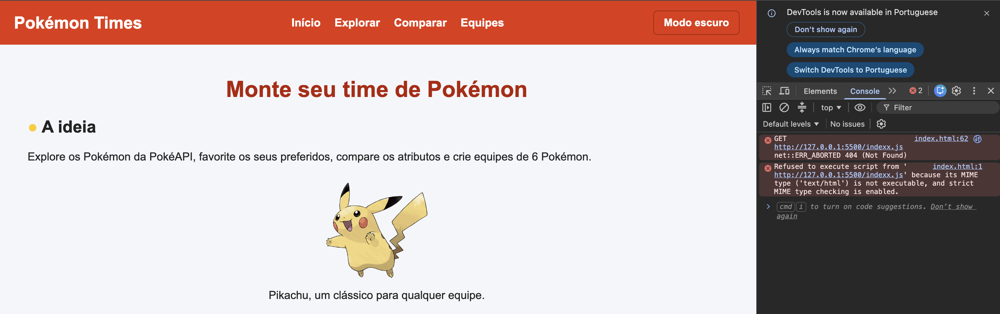
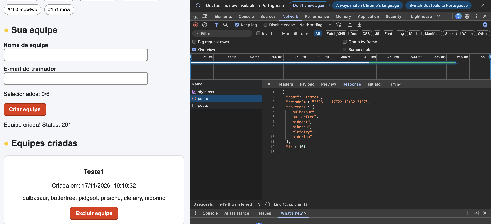
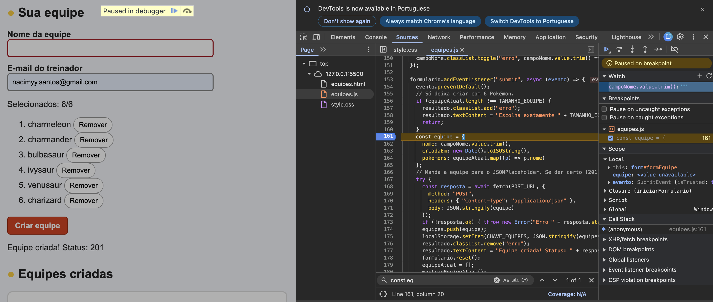

# Pokémon Times

Site para explorar Pokémon da PokéAPI, favoritar, comparar atributos e criar equipes de 6 Pokémon.

**Site publicado:** https://pedroguligurski.github.io/pokemon-teams-creator/

## Sobre o projeto

O tema escolhido foi Pokémon. O site usa a PokéAPI para buscar os 151 Pokémon da primeira geração e tem 4 páginas:

- **Início** (`index.html`): apresenta a ideia do site e mostra quantos favoritos o usuário tem.
- **Explorar** (`explorar.html`): mostra os Pokémon em cartões, com imagem, número, nome e tipo. Tem busca por nome em tempo real, botão de favoritar e filtro "só favoritos".
- **Comparar** (`comparacao.html`): o usuário escolhe 2 Pokémon e vê a tabela com os atributos lado a lado, a diferença, o total e a média. É a página da ferramenta do TDE 01.
- **Equipes** (`equipes.html`): o usuário escolhe 6 Pokémon, dá um nome para a equipe e informa o e-mail. O formulário envia a equipe por POST e ela fica salva no navegador.

Os favoritos, as equipes e o modo escuro ficam salvos no localStorage, então continuam lá depois de recarregar a página.

## Integrantes

- **Pedro Guligurski:** criou a estrutura inicial do site (`index.html`), o `index.js`, o `style.css` e este README. Também adicionou os comentários nos scripts, fez os ajustes finais e revisou os pull requests.
- **Luiza Wesp:** fez a página Explorar (`explorar.html` e `explorar.js`), com o GET na PokéAPI, os cartões, a busca e os favoritos.
- **Ruan Eduardo:** fez a página Comparar (`comparacao.html` e `comparacao.js`) e as funções da ferramenta do TDE 01.
- **Fatima Nacimy:** fez a página Equipes (`equipes.html` e `equipes.js`), com a montagem da equipe, o formulário com POST e a lista de equipes salvas.

## API

- **PokéAPI** (GET):
  - `https://pokeapi.co/api/v2/pokemon?limit=151` traz a lista com nome e URL de cada Pokémon.
  - `https://pokeapi.co/api/v2/pokemon/{id}` traz os detalhes (imagem, tipos e atributos).
- **JSONPlaceholder** (POST ao criar equipe): `https://jsonplaceholder.typicode.com/posts`. Ele não salva de verdade, mas devolve o status 201 quando a requisição está certa.

## TDE 01

A ferramenta está na página **Comparar** (`comparacao.js`). Ela compara os atributos de 2 Pokémon usando as funções abaixo.

| Função | Recebe | Devolve | Onde é usada |
| --- | --- | --- | --- |
| `somar(a, b)` | dois números | a soma | Dentro de `somarLista`, passada como callback para `calcular` |
| `subtrair(a, b)` | dois números | a diferença `a - b` | Em `mostrarComparacao`, para a coluna "Diferença" de cada atributo |
| `multiplicar(a, b)` | dois números | o produto | Em `mostrarComparacao`, para transformar a proporção em porcentagem (× 100) |
| `dividir(a, b)` | dois números | `a / b`, ou a mensagem `"divisão por zero"` se `b` for 0 | Em `calcularMedia` e na proporção entre os totais dos dois Pokémon |
| `calcular(a, b, operacao)` | dois números e uma função | o resultado de `operacao(a, b)` | É a função com **callback**. Usada como `calcular(stat.valor, valorB, subtrair)`, `calcular(totalA, totalB, dividir)` e `calcular(proporcao, 100, multiplicar)` |
| `somarLista(valores)` | um array de números | a soma de todos, com `reduce` | Para calcular o total de atributos de cada Pokémon |
| `calcularMedia(valores)` | um array de números | a média (soma ÷ quantidade) | Para mostrar a média dos atributos do primeiro Pokémon |

**Requisitos atendidos:**
- **Funções que manipulam arrays:** `somarLista` e `calcularMedia` calculam a média, e o `filter` em `mostrarComparacao` conta em quantos atributos o primeiro Pokémon é maior (filtro por condição).
- **Arrow functions:** `somarLista`, `calcularMedia` e as funções passadas para `map`, `filter` e `forEach`.
- **Função anônima:** `document.addEventListener("DOMContentLoaded", function () { ... })` no `index.js`.
- **Callback:** a função `calcular(a, b, operacao)`.

## TDE 02

Bugs que encontramos durante o desenvolvimento.

### Erro 1: arquivos `index.js` e `style.css` não encontrados (404)

- **Sintoma:** ao abrir a página Início, o Console mostrava em vermelho `GET .../index.js 404 (Not Found)` e `Refused to execute script ... because its MIME type ('text/html') is not executable`. O site aparecia sem estilo e o contador de favoritos ficava em 0.
- **Como foi identificado:** pelo **Console**. O erro mostrava a URL do arquivo e a linha do `index.html` que chamava ele (`index.html:62`), o que mostrou que o HTML chamava arquivos que ainda não existiam no repositório.
- **Solução:** criamos o `index.js` e o `style.css` na raiz, com os mesmos nomes usados no HTML.

Antes (o HTML chamava um arquivo que não existia):
```html
<link rel="stylesheet" href="style.css">
<script src="index.js"></script>
<!-- index.js e style.css não estavam no repositório -->
```

Depois (`index.js` criado):
```js
function mostrarFavoritos() {
  document.querySelector("#contadorFavoritos").textContent = lerFavoritos().length;
}
```



### Erro 2: e-mail do formulário não era enviado no POST (erro de lógica)

- **Sintoma:** o campo "E-mail do treinador" era obrigatório e a equipe era criada com status 201, mas o e-mail não chegava. O código rodava sem erro, só que o resultado estava errado.
- **Como foi identificado:** pela **aba Network**. Clicando na requisição `posts` e abrindo **Response**, o JSON enviado tinha `nome`, `criadaEm` e `pokemons`, mas não tinha `email`.
- **Solução:** pegar o valor do campo e colocar no objeto que vai no `body`.

Antes:
```js
const equipe = {
  nome: campoNome.value.trim(),
  criadaEm: new Date().toISOString(),
  pokemons: equipeAtual.map((p) => p.nome)
};
```

Depois:
```js
const campoEmail = document.querySelector("#emailTreinador");
// ...
const equipe = {
  nome: campoNome.value.trim(),
  email: campoEmail.value.trim(),
  criadaEm: new Date().toISOString(),
  pokemons: equipeAtual.map((p) => p.nome)
};
```



### Erro 3: equipe criada sem nome quando o nome tinha só espaços (erro de lógica)

- **Sintoma:** digitando só espaços no nome, o `required` deixava enviar. A equipe era criada com status 201 e aparecia em "Equipes salvas" com o título vazio.
- **Como foi identificado:** com um **breakpoint** na linha `const equipe = {` do `equipes.js` e a expressão `campoNome.value.trim()` no **Watch**. O Watch mostrava `""`, ou seja, o nome ficava vazio depois do `trim()` e mesmo assim o código continuava.
- **Solução:** conferir o nome sem espaços antes de enviar.

Antes:
```js
evento.preventDefault();
// Só deixa criar com 6 Pokémon.
if (equipeAtual.length !== TAMANHO_EQUIPE) {
```

Depois:
```js
evento.preventDefault();
// Não deixa criar equipe com nome só de espaços.
if (campoNome.value.trim() === "") {
  resultado.classList.add("erro");
  resultado.textContent = "Digite um nome para a equipe.";
  return;
}
// Só deixa criar com 6 Pokémon.
if (equipeAtual.length !== TAMANHO_EQUIPE) {
```


